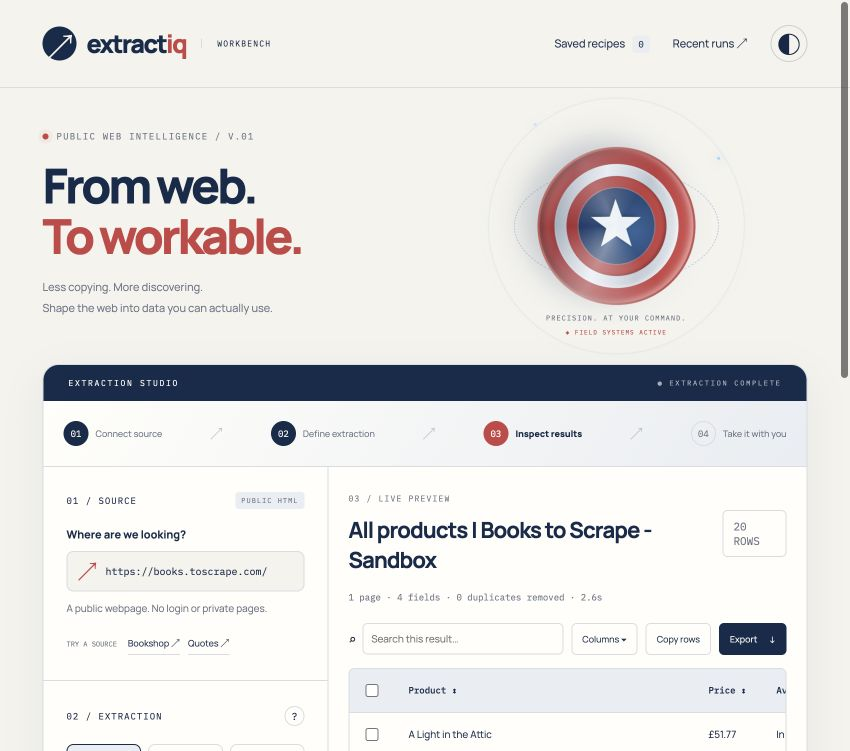

<div align="center">

# ExtractIQ
### From web. To workable.

[**Launch ExtractIQ ↗**](https://extract-iq-rachit.onrender.com) · [Source code](https://github.com/rachit1807/extract-iq)

An interactive web extraction workbench that turns public HTML into structured, searchable, exportable data.

<p>
 &nbsp;
 &nbsp;
 &nbsp;
 &nbsp;
 &nbsp;
 &nbsp;
 &nbsp;

</p>

</div>



## The workflow

**Connect source → define extraction → inspect results → export.**

ExtractIQ is a data preparation tool. Paste a public URL, choose a preset or define CSS selectors, inspect a real extraction, and take the result to a spreadsheet or another application. No account or database is required.

## What you can do

| Stage | Capabilities |
| --- | --- |
| Connect | Public HTTP/HTTPS URLs; working bookshop and quote-site examples |
| Define | Products, headlines, quotes, links, tables, or custom field mapping |
| Refine | Up to eight custom fields, supported HTML attributes, pagination, duplicate removal |
| Inspect | Search, natural text sorting, visible-column selection, row selection, paged result display |
| Export | UTF-8 CSV, structured JSON, or tab-separated clipboard values |
| Reuse | Named recipes and the last 15 successful run configurations, saved in the current browser |
| Personalize | Persistent light/dark theme, responsive layout, reduced-motion support |

The interface uses navy, red, and silver with an original CSS shield, animated energy rings, and a table-first workbench. The extraction controls and result pane remain part of the same workflow.

## Quick start

Requires **Node.js 22 or newer**.

```sh
npm ci
npm start
```

Open **http://localhost:3010**.

```sh
npm run dev   # Restart server on server-side source changes
npm test      # Parser, pagination, URL safety, and HTTP integration checks
```

Use **Bookshop** or **Quotes** to populate a source and preset. **Start with the sample bookshop** runs a real extraction against Books to Scrape; it does not insert invented rows.

## Custom extraction

A row selector identifies the repeating element. Field selectors are evaluated inside each row; `:scope` reads the row itself.

For the sample bookshop:

| Rule | Value |
| --- | --- |
| Source | `https://books.toscrape.com/` |
| Row selector | `.product_pod` |
| Title selector | `h3 a` → `text` |
| Price selector | `.price_color` → `text` |
| Product URL selector | `h3 a` → `href` |
| Next-page selector | `.next a` |

Supported field values: `text`, `href`, `src`, `content`, `title`, and `alt`. Relative URLs are resolved against the fetched page. Non-HTTP link values are omitted.

Presets target common structures and are starting points, not universal site adapters. Product extraction recognizes the sample bookshop, common product cards, and Product microdata. Headlines use common article and heading containers. Adjust custom rules when a site uses another structure.

## API

### `POST /api/extract`

Content type: `application/json`.

```json
{
  "url": "https://books.toscrape.com/",
  "preset": "products",
  "pages": 2,
  "nextSelector": ".next a",
  "dedupe": true
}
```

Custom requests additionally provide `rowSelector` and `fields`:

```json
{
  "url": "https://books.toscrape.com/",
  "preset": "custom",
  "rowSelector": ".product_pod",
  "fields": [
    { "name": "Title", "selector": "h3 a", "attribute": "text" },
    { "name": "Price", "selector": ".price_color", "attribute": "text" }
  ],
  "pages": 1,
  "dedupe": true
}
```

A successful response includes `title`, `columns`, `rows`, matched-node and duplicate counts, fetched page URLs, elapsed time, extraction timestamp, and warnings. If a later page fails, earlier page results are returned with a warning. If the first page fails, the request reports an error.

### `GET /api/health`

Returns `{ "status": "ok" }` for service checks.

## Network and parsing boundaries

- Only public HTTP/HTTPS destinations on standard web ports are accepted; embedded credentials are rejected.
- Hostnames are resolved, every returned address is checked, and the outbound connection is pinned to a checked address. Every redirect is validated again.
- Private, loopback, link-local, shared-address, and reserved ranges are rejected, including mapped IPv4 and private destinations encoded using the well-known NAT64 prefix.
- The source’s `robots.txt` policy is checked for the ExtractIQ user agent before page fetches. Unverifiable or blocking policies stop the run.
- Source scripts are removed from parsing; they are never executed or embedded in the interface.
- Response values are escaped before display. CSV and clipboard values that resemble spreadsheet formulas are prefixed to prevent formula execution.
- Requests, response sizes, page counts, redirects, custom fields, result rows, and concurrent runs are bounded.

These safeguards reduce common scraping and request-forgery risks. They are not a guarantee against every network configuration or abuse pattern. High-traffic public deployments should add a shared rate limiter, authentication where appropriate, and outbound network controls.

## Limits and expected behavior

| Limit | Current value |
| --- | --- |
| Pages per run | 1–3 |
| Rows per result | 1,000 |
| Custom fields | 1–8 |
| Table columns | Up to 30 across the run |
| HTML body | 2 MB per page, including decompressed size |
| Value length | 2,000 characters |
| Redirects | Up to 4 |
| Concurrent server runs | 3 |
| Attempts | 12 per minute per server-observed peer |
| Recent configurations | 15 |
| Saved recipes | 30 |

The server parses delivered HTML. JavaScript-rendered content, authentication walls, CAPTCHAs, PDFs, and sites blocking automated requests are not supported. ExtractIQ does not bypass these restrictions. Pagination follows matching links only within the page’s origin, detects loops, and stops at limits. Source sites retain ownership of their content; check their terms before reusing data.

The attempt limiter is in-process. On a reverse-proxied host, multiple visitors may share the server-observed peer and therefore the same quota. Recipes and run configurations are browser-local, can be cleared by browser settings, and do not synchronize between devices. Result rows are not saved to a server or database. Exports contain selected rows within the current filter; with no selection, all filtered rows are exported. Hidden columns are omitted.

## Architecture

```text
Browser workbench
   │ URL + extraction rules
   ▼
Node.js HTTP service
   │ validation + robots policy + DNS/address checks
   ▼
Public website HTML
   │ bounded responses + redirect validation
   ▼
Cheerio parser → field mapping → pagination → deduplication
   │ structured JSON
   ▼
Search / sort / select / export
```

| File | Responsibility |
| --- | --- |
| `server.js` | Same-origin API, static assets, concurrency and request controls |
| `network.js` | URL checks, address validation, pinned connections, robots policies |
| `extraction.js` | Presets, custom selectors, tables, pagination, duplicate removal |
| `public/` | Workbench interface, shield effects, browser-local recipes, exports |
| `test/` | Deterministic parser and API checks using different HTML structures |
| `.github/workflows/ci.yml` | Install and verify on pushes and pull requests |

## Deployment

Deploy one Node.js web service with:

- **Build:** `npm ci`
- **Start:** `npm start`
- **Environment:** `NODE_ENV=production`, Node.js 22+
- **Health check:** `/api/health`

The server binds to `0.0.0.0` and uses the host-provided `PORT` or `3010` locally. No database, paid disk, or credentials are needed. A free host may sleep after inactivity and has usage limits; the first request may take longer. Existing projects do not need configuration changes.

```sh
docker build -t extract-iq .
docker run --rm -p 3010:3010 extract-iq
```

## Design and accessibility

The interface includes labeled controls, keyboard focus states, semantic tables, native dialogs, status/error announcements, and mobile stacking. Animations stop when reduced motion is requested. Fonts use Google Fonts with local fallbacks. README icons are served by Simple Icons.

This independent portfolio project takes visual inspiration from Steve Rogers’ shield. The shield is drawn with original CSS and SVG; no official film artwork is bundled. Captain America and related characters belong to their respective rights holders. There is no affiliation or endorsement.

## Author

**Rachit Tripathi** · [GitHub](https://github.com/rachit1807)
